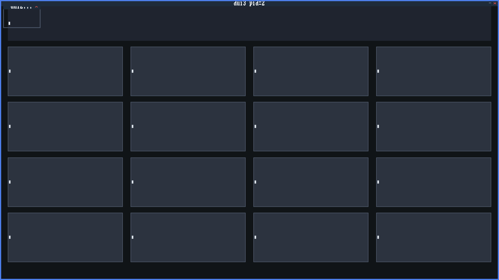

# 64-bit Calc

| field | value |
|-------|-------|
| binary | `GOCALC.ELF` |
| version | appver 1, ver 1.1.0 |
| owning spec / contract | [`tools/gate/specs/go-calc.spec`](https://github.com/drawmeanelephant/VirelaiOS/blob/main/tools/gate/specs/go-calc.spec) |
| state | shipped |

The calculator you reach for mid-session. The everyday mode is fixed-point
decimal arithmetic with a running history line; the programmer mode flips
to HEX/DEC/OCT/BIN with bitwise ops and shifts for the systems work. The
on-screen pad and the keyboard drive the same engine, so either hand
works — and like every catalog app its state rides the seat's save
envelope, so a snapshot or a tab close never loses the tape.

<!-- generated by tools/render-component-site.py from
     docs/registry/*.md — edit the row's fragment, or
     site/includes/apps/gocalc.story.md for showcase prose,
     not this file -->
